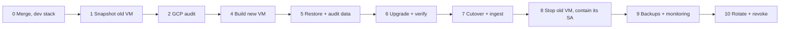

# Prod rebuild runbook (assume breach)

Mark's call on 2026-10-31: treat the current VM `omeka` as compromised. Prod moves to a new VM built from git and pinned upstream artifacts. Every secret the old VM held gets rotated. The rebuild also carries the PHP 8.5.12 / Omeka S 4.2.1 upgrade. Plan, versions and test results: [server-upgrade-2026-10.md](server-upgrade-2026-10.md).

Each numbered step needs Mark's explicit go-ahead (CLAUDE.md guardrails). Run `gcloud` on the laptop as Mark. Run VM commands over SSH on the VM the heading names.



Order matters at the end: the old identity loses bucket access (step 8) before the new VM writes its first backup (step 9). The backups carry the new secrets.

Variables for the laptop shell:

```bash
P=folkloric-rite-468520-r2; Z=us-east1-b; R=us-east1
OLD=omeka; NEW=catalog-2026-11
VMSA=catalog-vm@$P.iam.gserviceaccount.com
OLDSA=915596988253-compute@developer.gserviceaccount.com
```

## 0. Laptop: merge, then upgrade the dev stack

> [!warning] Deploy freeze
> From the merge until step 9 changes `PROD_HOST`, run zero `make deploy`. `PROD_HOST` still names the old VM. A deploy there would push the new modules onto the old DB and break faceted browse on the live site.

1. Merge the upgrade branch into `main`. Record the merge commit as `SHA`.
2. In the main checkout:

```bash
make modules                                   # pinned third-party modules
docker compose up -d --build omeka             # PHP 8.5.12 + Omeka 4.2.1 image
```

3. Admin > Modules at localhost:8888: Upgrade Common, then Log, BulkEdit, Custom Vocab, Faceted Browse. The Faceted Browse upgrade adds the missing `thumbnail_type` column itself.
4. Add Common's index (its background launcher fails; see the plan):

```bash
docker compose exec -T db mariadb -uomeka -pomeka omeka -e \
  "ALTER TABLE value ADD INDEX idx_property_value_resource (property_id, value_resource_id), ALGORITHM=INPLACE, LOCK=NONE"
```

## 1. Preserve the old VM (5 min)

```bash
DISK=$(gcloud compute instances describe $OLD --zone $Z --project $P --format='value(disks[0].source.basename())')
gcloud compute snapshots create omeka-forensic-$(date +%Y%m%d) --source-disk $DISK --source-disk-zone $Z --project $P
gcloud compute instances describe $OLD --zone $Z --project $P \
  --format='value(machineType.basename(),tags.items,networkInterfaces[0].accessConfigs[0].natIP)'
gcloud compute disks describe $DISK --zone $Z --project $P --format='value(sizeGb)'
```

Write down the machine type, tags, IP and disk size. Keep the snapshot for 90 days.

## 2. Measure the GCP blast radius (15 min)

The old VM ran as `$OLDSA` with the `cloud-platform` scope. Root on the VM had every role that account holds.

```bash
gcloud projects get-iam-policy $P --flatten=bindings \
  --filter="bindings.members:serviceAccount:$OLDSA" --format='value(bindings.role)'
gcloud iam service-accounts keys list --iam-account $OLDSA --managed-by=user --project $P
A="protoPayload.authenticationInfo"
WHO="($A.principalEmail=\"$OLDSA\" OR $A.serviceAccountDelegationInfo.firstPartyPrincipal.principalEmail=\"$OLDSA\")"
for log in activity data_access; do echo "== $log"
  gcloud logging read "$WHO AND logName:\"cloudaudit.googleapis.com%2F$log\"" \
    --project $P --freshness=400d --limit 500 \
    --format='table(timestamp,protoPayload.authenticationInfo.principalEmail,protoPayload.methodName,protoPayload.resourceName)'
done
gcloud storage buckets describe gs://catalog-jonsarkin-backups \
  --format='yaml(versioning,retention_policy,soft_delete_policy)'
gcloud storage buckets get-iam-policy gs://catalog-jonsarkin-backups
```

`WHO` matches the old SA directly and through impersonation. With impersonation the log names `catalog-backups` as the principal and records `$OLDSA` in `serviceAccountDelegationInfo`.

Expected in `activity` (Admin Activity, always on): zero entries, because the backups only write objects. Expected in `data_access`: token minting for `catalog-backups` and `storage.objects.create`. These entries exist only if Data Access logging was on for IAM and Cloud Storage; an empty list there proves nothing. Escalate on anything else: `SetIamPolicy`, `CreateServiceAccountKey`, `compute.instances.insert`, firewall changes, `setMetadata` (SSH keys), object deletes. A role of `roles/editor` on `$OLDSA` widens the review to every project resource. If the backups SA can overwrite or delete objects and versioning is off, treat older backups as equally suspect.

## 3. Optional: host triage on the old VM (30 min)

The 2026-10-31 read-only check covered the application layer (see the plan). These host checks add evidence. A rootkit can hide from them, so the rebuild goes ahead whatever they show.

```bash
ssh omeka.us-east1-b.folkloric-rite-468520-r2
sudo last -Faiw | head -40; sudo lastb -Fai | head -20
sudo grep -h "Accepted" /var/log/auth.log* | awk '{print $1,$2,$3,$9,$11}' | sort | uniq -c | sort -rn | head
for u in root ubuntu mark; do echo "== $u"; sudo cat /home/$u/.ssh/authorized_keys /root/.ssh/authorized_keys 2>/dev/null; done
sudo ls -la /etc/cron.d /etc/systemd/system; for u in root ubuntu mark; do sudo crontab -l -u $u; done
sudo find /etc /usr/local /opt /root /home -xdev -newer /etc/hostname -type f -mtime -120 | grep -vE '/\.cache/|/opt/catalog/' | head -50
sudo ss -tunap | grep -v -E '127.0.0.1|::1'
docker ps -a; docker images
sudo debsums -s 2>/dev/null | head      # sudo apt-get install debsums first
```

## 4. Build the new VM (45 min)

Laptop: a dedicated service account with minimal roles, a new static IP, the VM.

```bash
gcloud iam service-accounts create catalog-vm --project $P --display-name "catalog VM"
for r in roles/logging.logWriter roles/monitoring.metricWriter; do
  gcloud projects add-iam-policy-binding $P --member serviceAccount:$VMSA --role $r; done
gcloud iam service-accounts add-iam-policy-binding catalog-backups@$P.iam.gserviceaccount.com \
  --member serviceAccount:$VMSA --role roles/iam.serviceAccountTokenCreator --project $P
gcloud compute addresses create catalog-2026-11 --region $R --project $P
gcloud compute instances create $NEW --zone $Z --project $P \
  --machine-type <old machine type> --boot-disk-size <old size>GB \
  --image-family debian-13 --image-project debian-cloud \
  --service-account $VMSA --scopes cloud-platform \
  --address catalog-2026-11 --tags <old tags> \
  --shielded-secure-boot --shielded-vtpm --shielded-integrity-monitoring
gcloud compute config-ssh --project $P
```

New VM: Debian 13 (trixie). Packages come from the Debian archive, Docker's signed apt repo and Google's repos. On top of the stock image, the host gets Docker, git, unzip, gnupg and the patch tools. The stock image also runs exim4 for local mail.

`apt_get` runs apt with zero prompts, so a pasted block runs line by line. The needrestart settings go in before the package that reads them. The key check accepts exactly one primary key, Docker's. On a mismatch it deletes the key, so apt refuses Docker's repo and the docker-ce install fails.

```bash
ssh $NEW.$Z.$P
apt_get() { sudo DEBIAN_FRONTEND=noninteractive apt-get -y -o DPkg::Lock::Timeout=600 \
  -o Dpkg::Options::=--force-confdef -o Dpkg::Options::=--force-confold "$@"; }
sudo install -d /etc/needrestart/conf.d
printf '%s\n' '$nrconf{restart} = "a";' '$nrconf{kernelhints} = -1;' | sudo tee /etc/needrestart/conf.d/catalog.conf >/dev/null
apt_get update && apt_get full-upgrade
apt_get install git unzip gnupg cron file unattended-upgrades needrestart
sudo install -m 0755 -d /etc/apt/keyrings
sudo curl -fsSL https://download.docker.com/linux/debian/gpg -o /etc/apt/keyrings/docker.asc
[ "$(gpg --show-keys --with-colons /etc/apt/keyrings/docker.asc | awk -F: '$1=="pub" {getline; print $10}')" \
  = 9DC858229FC7DD38854AE2D88D81803C0EBFCD88 ] \
  || { sudo rm -f /etc/apt/keyrings/docker.asc; echo "DOCKER KEY MISMATCH: stop and investigate"; }
sudo tee /etc/apt/sources.list.d/docker.sources >/dev/null <<'EOF'
Types: deb
URIs: https://download.docker.com/linux/debian
Suites: trixie
Components: stable
Signed-By: /etc/apt/keyrings/docker.asc
EOF
apt_get update
apt_get install docker-ce docker-ce-cli containerd.io docker-buildx-plugin docker-compose-plugin
sudo usermod -aG docker $USER              # applies after the reboot below
curl -sSO https://dl.google.com/cloudagents/add-google-cloud-ops-agent-repo.sh \
  && sudo DEBIAN_FRONTEND=noninteractive bash add-google-cloud-ops-agent-repo.sh --also-install
sudo mkdir -p /opt/catalog /var/www/omeka-s/files && sudo chown $USER /opt/catalog /var/www/omeka-s/files
git clone https://github.com/aphelionz/catalog.jonsarkin.com.git /opt/catalog
cd /opt/catalog && git checkout <SHA> && git log -1 --oneline
bash scripts/fetch-omeka-modules.sh
```

Patching: unattended-upgrades installs updates from Debian stable and security, Docker and Google's repos. Apt's timer runs it between 06:00 and 07:00 UTC, after the backup jobs. needrestart restarts each service whose libraries changed. Docker is on needrestart's default skip list, so dockerd picks up library fixes at the next Docker update or reboot. A Docker update restarts the daemon and its containers, about one minute of downtime. An update that needs a reboot (a new kernel) reboots the VM at 07:30 UTC. The compose services come back on their `restart` policies.

The six Docker packages stay on the major versions installed here. To move one to a new major, test it first, then edit `/etc/apt/preferences.d/docker-major`. A failed pin prints `DOCKER PIN FAILED` and writes zero pins. The nightly run stays off until step 9, so the box stays up through restore and cutover.

```bash
sudo tee /etc/apt/apt.conf.d/52catalog-upgrades >/dev/null <<'EOF'
Unattended-Upgrade::Origins-Pattern {
  "origin=Docker";
  "site=packages.cloud.google.com";
};
Unattended-Upgrade::Automatic-Reboot "true";
Unattended-Upgrade::Automatic-Reboot-Time "07:30";
EOF
sudo tee /etc/apt/apt.conf.d/20auto-upgrades >/dev/null <<'EOF'
APT::Periodic::Update-Package-Lists "1";
APT::Periodic::Unattended-Upgrade "0";
EOF
pin() { local v; v=$(dpkg-query -W -f='${Version}' "$1" | sed -nE 's/^([0-9]+:)?([0-9]+)\..*/\1\2/p')
  [ -n "$v" ] && printf 'Package: %s\nPin: version %s.*\nPin-Priority: 990\n\n' "$1" "$v"; }
pins=$(for p in docker-ce docker-ce-cli docker-ce-rootless-extras containerd.io docker-compose-plugin \
  docker-buildx-plugin; do pin $p || exit 1; done) \
  && printf '%s\n' "$pins" | sudo tee /etc/apt/preferences.d/docker-major >/dev/null \
  || echo "DOCKER PIN FAILED: stop and investigate"
grep Pin: /etc/apt/preferences.d/docker-major   # expect six lines, such as 5:29.*, 2.*, 5.* and 0.*
sudo reboot
```

SSH in again. The reboot loads the patched kernel and applies the docker group.

```bash
ssh $NEW.$Z.$P
sudo needrestart -b -k | grep KSTA         # expect NEEDRESTART-KSTA: 1 (newest kernel running)
docker info -f '{{.ServerVersion}}'; docker compose version   # the docker group works
command -v gcloud crontab file             # expect three paths; Google lists gcloud as installed on Debian 13
df / | tail -1                             # root device, for ROOT_DEVICE in step 9
```

Laptop: accept the patched kernel's boot measurements as the Shielded VM integrity baseline.

```bash
gcloud compute instances update $NEW --zone $Z --project $P --shielded-learn-integrity-policy
```

Secrets: generate new ones. Create the new Anthropic key and the new Gmail app password first, then paste them.

```bash
cd /opt/catalog && umask 077
cat > .env <<EOF
COMPOSE_FILE=docker-compose.prod.yml
MYSQL_DATABASE=omeka
MYSQL_USER=omeka
MYSQL_PASSWORD=$(openssl rand -hex 24)
MYSQL_ROOT_PASSWORD=$(openssl rand -hex 24)
ANTHROPIC_API_KEY=<new key>
SMTP_USER=<smtp user>
SMTP_PASS=<new app password>
EOF
touch acme.json && chmod 600 acme.json
```

`COMPOSE_FILE` makes every plain `docker compose` on the VM (the backup scripts included) read the prod file. The old VM ran `db`, `qdrant` and `clip-api` from the dev file.

Images: build both locally. The prod compose names `aphelionz/sarkin-clip-api`; a local build keeps Docker Hub out of the path, so skip `docker compose pull`.

```bash
cd /opt/catalog
docker compose build omeka
docker build -t aphelionz/sarkin-clip-api:latest -f sarkin-clip/Dockerfile.api sarkin-clip/
docker compose up -d db
```

## 5. Restore and audit the data (1 to 2 h)

Content freeze: announce it, then make zero admin edits on the old site from here to cutover. Two public forms keep writing to the old DB: collector submissions (`/submit`, with photos) and the SiteLockdown email signup. CollectorSubmission has no off switch, and its link sits in every page header, so deactivating the module would break the site. Step 8 copies any late rows instead.

Old VM: take a fresh dump and a fresh files sync into the bucket. `all` runs both, so the DB and the files restore from the same frozen state.

```bash
ssh omeka.us-east1-b.folkloric-rite-468520-r2 '/opt/catalog/scripts/backup-to-gcs.sh all'
```

New VM: fetch the dump and audit it in a scratch container first.

```bash
G="gcloud storage --impersonate-service-account=catalog-backups@folkloric-rite-468520-r2.iam.gserviceaccount.com"
D=/tmp/restore; mkdir -p $D
$G ls -l gs://catalog-jonsarkin-backups/daily/ | tail -3
$G cp gs://catalog-jonsarkin-backups/daily/omeka-<stamp>.sql.gz $D/
docker run -d --name audit -e MARIADB_ROOT_PASSWORD=scratch mariadb:10.11
until docker exec audit healthcheck.sh --connect; do sleep 1; done
docker exec -e MYSQL_PWD=scratch audit mariadb -uroot -e "CREATE DATABASE omeka"
gunzip -c $D/omeka-*.sql.gz | docker exec -i -e MYSQL_PWD=scratch audit mariadb -uroot --one-database omeka
docker exec -i -e MYSQL_PWD=scratch audit mariadb -uroot omeka <<'SQL'
SELECT id, email, role, is_active, created, modified FROM user ORDER BY created;
SELECT id, owner_id, label, created, last_accessed, last_ip FROM api_key ORDER BY created;
SELECT id, is_active, version FROM module ORDER BY id;
SELECT id, slug, LEFT(navigation, 300) FROM site WHERE navigation REGEXP 'javascript:';
SELECT id, LEFT(value, 200) FROM setting WHERE value REGEXP '<script|javascript:|onerror=|onload=|<iframe|https?://';
SELECT site_id, id, LEFT(value, 200) FROM site_setting WHERE value REGEXP '<script|javascript:|onerror=|onload=|<iframe';
SELECT b.id, p.slug, LEFT(b.data, 200) FROM site_page_block b JOIN site_page p ON p.id = b.page_id
  WHERE b.data REGEXP '<script|javascript:|onerror=|onload=|<iframe';
SELECT resource_id, property_id, LEFT(COALESCE(value, uri), 200) FROM value
  WHERE value REGEXP '<script|javascript:|onerror=|onload=|<iframe' OR uri REGEXP '^javascript:';
SELECT id, ingester, LEFT(data, 200) FROM media WHERE ingester IN ('html', 'oembed') AND data REGEXP '<script|onerror=|<iframe';
SQL
cat > $D/objects.sql <<'SQL'
SELECT 'trigger', TRIGGER_NAME, DEFINER FROM information_schema.TRIGGERS WHERE TRIGGER_SCHEMA = 'omeka'
UNION ALL SELECT 'routine', ROUTINE_NAME, DEFINER FROM information_schema.ROUTINES WHERE ROUTINE_SCHEMA = 'omeka'
UNION ALL SELECT 'event', EVENT_NAME, DEFINER FROM information_schema.EVENTS WHERE EVENT_SCHEMA = 'omeka'
UNION ALL SELECT 'view', TABLE_NAME, DEFINER FROM information_schema.VIEWS WHERE TABLE_SCHEMA = 'omeka';
SQL
docker exec -i -e MYSQL_PWD=scratch audit mariadb -uroot omeka < $D/objects.sql
```

Expected: the known users and modules, settings whose URLs point at our own hosts, and page or media embeds Mark recognizes. Delete or fix anything else in the scratch DB before the re-export below, then record it here.

The last query lists code stored in the DB. The dump carries triggers, routines and events (`--routines --triggers --events`). Omeka and our modules create none: the local DB returned zero rows on 2026-10-31. Any row here is an attacker's foothold. Stop and review it with Mark.

The real DB imports a re-export from the scratch container. `--one-database` only filters statements by their `USE`; root could still run a `GRANT`, a `CREATE USER` or a write to a fully qualified `mysql.*` table from the source dump. The scratch container absorbs whatever that dump does and is then deleted. The re-export holds only the `omeka` tables and their rows. The app user imports it, and its grants cover `omeka.*` only. Tested 2026-10-31 on a dump with the backup's flags: all 52 tables checksum-identical to the source.

```bash
docker exec -e MYSQL_PWD=scratch audit mariadb-dump -uroot --single-transaction --quick --hex-blob \
  --skip-triggers --no-create-db omeka > $D/omeka-clean.sql
docker rm -f audit
cd /opt/catalog
docker compose exec -T db sh -c 'MYSQL_PWD=$MARIADB_PASSWORD mariadb -u"$MARIADB_USER" omeka' < $D/omeka-clean.sql
docker compose exec -T db sh -c 'MYSQL_PWD=$MARIADB_PASSWORD mariadb -u"$MARIADB_USER" omeka' < $D/objects.sql   # expect zero rows
docker compose exec -T db sh -c 'MYSQL_PWD=$MARIADB_PASSWORD mariadb -u"$MARIADB_USER" omeka' <<'SQL'
TRUNCATE session;
DELETE FROM api_key;
DELETE FROM password_creation;
UPDATE user SET password_hash = CONCAT('!locked-', SHA2(RAND(), 256));
SELECT COUNT(*) items FROM item; SELECT COUNT(*) media FROM media;
SQL
docker compose exec -T db sh -c 'MYSQL_PWD=$MARIADB_PASSWORD mariadb -u"$MARIADB_USER" -N omeka -e \
  "SELECT COALESCE(MAX(id), 0) FROM collector_submission; SELECT COALESCE(MAX(id), 0) FROM prelaunch_signup"' | tee ~/cutoffs.txt
```

`~/cutoffs.txt` holds the restored cutoffs `N1` (submissions) and `N2` (signups). Write them here as well. Step 8 needs these values, because after cutover the new VM takes public writes of its own.

Files: restore from the bucket (recovery runbook §4), then sweep for code and script-bearing files.

```bash
umask 022      # step 4 set 077 for .env; media must stay readable for the files backup
$G rsync --recursive gs://catalog-jonsarkin-backups/files/ /var/www/omeka-s/files/
cd /var/www/omeka-s/files
find . -type f | sed -nE 's/.*\.([^./]+)$/\1/p' | tr A-Z a-z | sort | uniq -c | sort -rn
find . -type f \( -iname '*.php*' -o -iname '*.phtml' -o -iname '*.phar' -o -iname '.htaccess' -o -iname '*.js' \) -print
find . -type f \( -iname '*.svg' -o -iname '*.htm*' -o -iname '*.xml' \) -print0 | xargs -0 -r grep -lis '<script\|onload=\|javascript:'
find original -type f -print0 | xargs -0 file --mime-type | grep -vE ': (image|video|audio)/|: application/pdf$'
sudo chown -R 33:33 /var/www/omeka-s/files
```

The first `find` is an inventory of extensions. Delete every hit from the second `find`, the code sweep (PHP, PHTML, PHAR, `.htaccess`, JavaScript). Review the SVG, HTML and MIME-type hits with Mark before deleting.

Qdrant and the search index start empty; skip recovery runbook §5. A restored store keeps every point and row it held, and an ingest only overwrites the items it touches. Points for deleted items, or an attacker's points, would survive. Step 7 fills both stores from the audited DB. The FTS index needs nothing: clip-api creates it on the first ingest. Qdrant needs the empty collection (tested against Qdrant v1.16 on 2026-10-31):

```bash
cd /opt/catalog && docker compose up -d qdrant clip-api
docker compose exec -T clip-api python - <<'PY'
import json, urllib.request as u
q = "http://qdrant:6333/collections/omeka_items"
def put(url, body):
    req = u.Request(url, data=json.dumps(body).encode(), method="PUT",
                    headers={"Content-Type": "application/json"})
    print(u.urlopen(req).read().decode())
put(q, {"vectors": {n: {"size": 512, "distance": "Cosine"} for n in ("visual_vec", "text_vec_clip")},
        "on_disk_payload": True})
for field, kind in [("omeka_item_id", "integer"), ("year", "integer"), ("subjects", "keyword"),
                    ("collection", "keyword"), ("dominant_color", "keyword")]:
    put(q + "/index?wait=true", {"field_name": field, "field_schema": kind})
PY
```

## 6. Upgrade and verify on the new VM (30 min)

```bash
cd /opt/catalog
docker compose exec -T db sh -c 'MYSQL_PWD=$MARIADB_ROOT_PASSWORD mariadb-dump -uroot omeka' | gzip > /tmp/pre-upgrade.sql.gz
docker compose up -d
```

Set Mark's admin password. The prompt reads it silently; the hash goes to the DB.

```bash
read -rs PW; H=$(printf '%s' "$PW" | docker compose exec -T omeka php -r 'echo password_hash(stream_get_contents(STDIN), PASSWORD_DEFAULT);'); unset PW
printf "UPDATE user SET password_hash='%s' WHERE email='%s';\n" "$H" "<mark's admin email>" | \
  docker compose exec -T db sh -c 'MYSQL_PWD=$MARIADB_ROOT_PASSWORD mariadb -uroot omeka'
```

Test the new VM by IP before DNS moves. Traefik serves a self-signed cert until DNS points here, so use `-k`.

```bash
NEWIP=$(gcloud compute addresses describe catalog-2026-11 --region $R --project $P --format='value(address)')
for u in /api/items /faceted-browse/2 /item/7308 /visual-search /admin; do
  curl -sk -o /dev/null -w "%{http_code} $u\n" --resolve catalog.jonsarkin.com:443:$NEWIP "https://catalog.jonsarkin.com$u"; done
```

For the admin, add `<NEWIP> catalog.jonsarkin.com` to the laptop's `/etc/hosts`, accept the self-signed cert, and remove the line before step 7:

1. Modules: Upgrade Common, then Log, BulkEdit, Custom Vocab, Faceted Browse. Faceted Browse adds its missing `thumbnail_type` column.
2. Common's index:

```bash
docker compose exec -T db sh -c 'MYSQL_PWD=$MARIADB_ROOT_PASSWORD mariadb -uroot omeka -e \
  "ALTER TABLE value ADD INDEX idx_property_value_resource (property_id, value_resource_id), ALGORITHM=INPLACE, LOCK=NONE"'
```

3. Check: faceted browse with a filter, an item page, RapidEditor loads, Enrich Fields loads, ICC Thumbnailer page, a test upload through Simple Upload (its thumbnails keep the ICC profile), "Forgot password" email arrives. Similar works and visual search stay empty until the ingest in step 7.

## 7. Cutover (15 min plus DNS)

1. One day ahead: lower the TTL of the `catalog.jonsarkin.com` A record at DreamHost to 300.
2. Point the A record at `$NEWIP`.
3. Watch Traefik get the certificate: `docker compose logs -f traefik | grep -i acme`.
4. Verify from the laptop:

```bash
curl -4 -sS -o /dev/null -w "%{http_code}\n" https://catalog.jonsarkin.com/api/items   # 200
curl -4 -sS -o /dev/null -w "%{http_code}\n" https://catalog.jonsarkin.com/            # 301
```

5. Admin > Enrich Fields > Ingest All Items. It calls clip-api only (zero Claude cost) and fills Qdrant and the search index from the audited DB. It runs after the DNS switch because clip-api fetches each image from `catalog.jonsarkin.com`, which named the old VM until now. Follow it in Admin > Jobs. When it finishes, check similar works on an item page and a visual search.

## 8. Stop the old VM and contain its identity

Run this once the new VM serves the traffic (step 7.4). The old VM's final exports use the old identity, so they go first.

Late public rows: list the old DB's rows above the step 5 cutoffs `N1` and `N2`. Use the recorded values; the new VM's live maximum now includes its own post-cutover rows. The old VM runs `db` from the dev compose file, as `make pull-db` assumes.

```bash
ssh omeka.us-east1-b.folkloric-rite-468520-r2 'cd /opt/catalog && . ./.env && docker compose exec -T db \
  mariadb -u"$MYSQL_USER" -p"$MYSQL_PASSWORD" omeka -e \
  "SELECT id, email, created FROM collector_submission WHERE id > <N1>; SELECT id, email, created FROM prelaunch_signup WHERE id > <N2>"'
```

Expect zero rows. On any row, merge the late rows before the stop. Both VMs hand out the next IDs after the cutoffs, so the late rows go through staging tables and take fresh IDs on the new VM. A signup whose email is already on the new VM is skipped. The confirmation email cites only the submitter's name, so a new ID changes nothing for the submitter. Tested 2026-10-31 against a simulated collision.

The old VM's dump is untrusted SQL, so it follows step 5's pattern. It runs only in a scratch container, and the live DB gets a fresh dump of that container. A prefix check on the old dump is too weak, because a line can carry an `INSERT` and then any other statement.

Laptop: dump the late rows and copy the file to the new VM.

```bash
OLDDUMP() { ssh omeka.us-east1-b.folkloric-rite-468520-r2 "cd /opt/catalog && . ./.env && docker compose exec -T db \
  mariadb-dump -u\"\$MYSQL_USER\" -p\"\$MYSQL_PASSWORD\" --compact --no-create-info --skip-extended-insert --where='id > $2' omeka $1"; }
{ OLDDUMP collector_submission <N1>; OLDDUMP prelaunch_signup <N2>; } > late.sql
ssh omeka.us-east1-b.folkloric-rite-468520-r2 '/opt/catalog/scripts/backup-to-gcs.sh files'   # late photos to the bucket
scp late.sql $NEW.$Z.$P:
```

New VM: load `late.sql` into a scratch container that holds only the two empty tables, with the live schema. Then re-export the rows and list the photo names they cite.

```bash
cd /opt/catalog
docker run -d --name late -e MARIADB_ROOT_PASSWORD=scratch -e MARIADB_DATABASE=omeka mariadb:10.11
until docker exec late healthcheck.sh --connect; do sleep 1; done
LATE() { docker exec -i -e MYSQL_PWD=scratch late "$@"; }
docker compose exec -T db sh -c 'MYSQL_PWD=$MARIADB_PASSWORD mariadb-dump -u"$MARIADB_USER" --no-data --skip-triggers \
  omeka collector_submission prelaunch_signup' | LATE mariadb -uroot omeka
LATE mariadb -uroot omeka < ~/late.sql      # any error: stop, keep the container, review late.sql with Mark
LATE mariadb-dump -uroot --compact --no-create-info --skip-extended-insert --skip-triggers omeka collector_submission prelaunch_signup \
  | sed -E 's/^INSERT INTO `(collector_submission|prelaunch_signup)`/INSERT INTO `late_\1`/' > ~/late-clean.sql
LATE mariadb -uroot -N omeka -e "SELECT jt.f FROM collector_submission,
  JSON_TABLE(files, '\$[*]' COLUMNS (f VARCHAR(512) PATH '\$')) jt" > ~/late-files.txt
docker rm -f late
```

New VM: merge `late-clean.sql` through the staging tables as the app user. Its row count must match the old VM's listing above.

```bash
APP() { docker compose exec -T db sh -c 'MYSQL_PWD=$MARIADB_PASSWORD mariadb -u"$MARIADB_USER" omeka'; }
echo "CREATE TABLE late_collector_submission LIKE collector_submission;
      CREATE TABLE late_prelaunch_signup LIKE prelaunch_signup;" | APP
APP < ~/late-clean.sql
APP <<'SQL'
SELECT GROUP_CONCAT('`', COLUMN_NAME, '`' ORDER BY ORDINAL_POSITION) INTO @c FROM information_schema.COLUMNS
  WHERE TABLE_SCHEMA = 'omeka' AND TABLE_NAME = 'collector_submission' AND COLUMN_NAME <> 'id';
SET @s = CONCAT('INSERT INTO collector_submission (', @c, ') SELECT ', @c, ' FROM late_collector_submission ORDER BY id');
PREPARE st FROM @s; EXECUTE st; DEALLOCATE PREPARE st;
INSERT IGNORE INTO prelaunch_signup (email, created, ip_address, user_agent)
  SELECT email, created, ip_address, user_agent FROM late_prelaunch_signup ORDER BY id;
DROP TABLE late_collector_submission, late_prelaunch_signup;
SQL
```

New VM: fetch only the photos the late rows cite, into a directory the SSH user owns. Both checks use the collector form's own allowlist: the names it generates (`<time>_<8 hex>_<safe name>.jpg` or `.png`; HEIC uploads become `.jpg`) and the MIME types it accepts. Any hit stops the copy for review with Mark. Then install the files into the live tree as `33:33`, which owns it since step 5.

```bash
grep -vE '^submissions/[0-9]+_[0-9a-f]{8}_[A-Za-z0-9._-]*\.(jpg|png)$' ~/late-files.txt   # expect nothing
G="gcloud storage --impersonate-service-account=catalog-backups@folkloric-rite-468520-r2.iam.gserviceaccount.com"
S=~/late-photos; mkdir -p $S
while read -r f; do $G cp "gs://catalog-jonsarkin-backups/files/$f" $S/; done < ~/late-files.txt
file --mime-type $S/* | grep -vE ': image/(jpeg|png|heic|heif)$'                           # expect nothing
sudo install -o 33 -g 33 -m 644 $S/* /var/www/omeka-s/files/submissions/
```

Tested 2026-11-01 with a hostile `late.sql`: an `UPDATE` appended to an `INSERT` line failed inside the scratch container and stopped the import, the re-export held only `INSERT`s, the name check caught a `../` path, and the MIME check caught an SVG named `.jpg`.

Then stop the old VM and contain its identity:

```bash
ssh omeka.us-east1-b.folkloric-rite-468520-r2 '/opt/catalog/scripts/backup-to-gcs.sh accesslog $(date -u +%Y-%m)'
gcloud compute instances stop $OLD --zone $Z --project $P
gcloud iam service-accounts remove-iam-policy-binding catalog-backups@$P.iam.gserviceaccount.com \
  --member serviceAccount:$OLDSA --role roles/iam.serviceAccountTokenCreator --project $P
gcloud storage buckets get-iam-policy gs://catalog-jonsarkin-backups | grep -n "$OLDSA"   # expect nothing
gcloud compute instances list --project $P --format='value(name,serviceAccounts[0].email)'
```

Then remove every project role that step 2 found on `$OLDSA`, and delete its user-managed keys. The last command lists other VMs that run as the default compute SA; keep any role they need.

Access tokens already minted for `catalog-backups` stay valid until they expire (one hour by default). Wait one hour before step 9.

Keep the old disk and the forensic snapshot for 90 days. Deletion is Mark's call after that.

## 9. Backups and monitoring on the new VM

The backup jobs run as the SSH user. They write a log, a lock and per-job success stamps. Provision the root-owned paths, prove one full run, and seed the weekly and monthly stamps from the bucket before cron starts. Without those stamps the monitor reports both jobs as stale at once. The jobs keep their own log, so `MAILTO=""` keeps their output out of exim4's local mailbox.

```bash
sudo install -d -o $USER /var/lib/catalog-backup
sudo install -o $USER -m 644 /dev/null /var/log/catalog-backup.log
/opt/catalog/scripts/backup-to-gcs.sh all          # daily + files; proves the new SA can write
/opt/catalog/scripts/backup-monitor.sh bootstrap   # weekly and monthly stamps from the bucket
ls -l /var/lib/catalog-backup                      # expect four last-success-* stamps
crontab - <<'EOF'
PATH=/usr/local/sbin:/usr/local/bin:/usr/sbin:/usr/bin:/sbin:/bin
SHELL=/bin/bash
MAILTO=""
0 2 * * *  /opt/catalog/scripts/backup-to-gcs.sh daily
0 3 * * *  /opt/catalog/scripts/backup-to-gcs.sh files
0 4 * * 0  /opt/catalog/scripts/backup-to-gcs.sh weekly
0 5 1 * *  /opt/catalog/scripts/backup-to-gcs.sh monthly
17 * * * * /opt/catalog/scripts/backup-monitor.sh >/dev/null 2>&1
30 1 * * * /opt/catalog/scripts/prune-sessions.sh >/dev/null 2>&1
EOF
```

Turn on nightly patching. From here on, a kernel update reboots the VM at 07:30 UTC.

```bash
sudo tee /etc/apt/apt.conf.d/20auto-upgrades >/dev/null <<'EOF'
APT::Periodic::Update-Package-Lists "1";
APT::Periodic::Unattended-Upgrade "1";
EOF
apt-config dump | grep 'Origins-Pattern::'   # expect Debian, Debian-Security, origin=Docker, site=packages.cloud.google.com
apt-cache policy docker-ce | sed -n 2,3p     # Installed and Candidate on the same major
```

A kernel, shim, GRUB or initramfs update changes the boot measurements, so the next boot logs a Shielded VM integrity failure. The "Catalog VM boot integrity failed" alert emails each one. When it fires, look for one of those updates before that boot:

```bash
grep -E ' (install|upgrade) (linux-image|shim|grub)|trigproc initramfs' /var/log/dpkg.log | tail
```

If one matches, re-learn the baseline with step 4's `--shielded-learn-integrity-policy` command. Treat any other integrity failure as an incident.

Laptop: in `scripts/setup-gcp-monitoring.sh`, set `VM_NAME="catalog-2026-11"`. Set `ROOT_DEVICE` to the device from step 4's `df /` once Metrics Explorer shows that same device name on `agent.googleapis.com/disk/percent_used` for the new VM. Commit the change to `main`, so a later re-run keeps both values. Re-run the script so host alerts follow the new instance. Update the SSH host alias in `Makefile` (`PROD_HOST`) and `omeka/ansible/inventory.ini` to `$NEW.$Z.$P`. That ends the deploy freeze from step 0.

End the content freeze.

## 10. Rotate and revoke

| Secret | Held by the old VM in | Action |
|---|---|---|
| Anthropic API key | `.env` | Revoke the old key in the Anthropic console (the new VM has a new one). |
| Gmail app password (SMTP) | `.env` | Revoke the old app password in the Google account. |
| MariaDB passwords | `.env`, DB grants | Done: the new VM generated new ones and skipped the old grants. |
| Omeka passwords, API keys, sessions | DB | Done in step 5. Each user sets a new password through "Forgot password". Recreate API keys only where needed. |
| SiteLockdown password | DB setting | Set a new one in the module config. |
| Default compute SA `$OLDSA` | VM identity | Done in step 8, before the first backup that carries new secrets. |
| SSH keys in `authorized_keys` and GCE metadata | VM | Remove old entries from project metadata. Mark checks the laptop's `~/.ssh/config` for `ForwardAgent` to this host; if it was on, generate a new laptop key. |
| TLS key in `acme.json` and `/etc/letsencrypt` | VM | The new VM issued its own. Revoking the old certificate is optional. |
| Old static IP | GCP | Release it after the 90 days. |

## Rollback

- Before step 7: users still reach the old VM. Stop or delete the new one.
- Upgrade problem on the new VM: restore `/tmp/pre-upgrade.sql.gz`. Check out `omeka/Dockerfile` and `omeka/volume/modules/FacetedBrowse` from the merge's first parent (`git checkout <SHA>^1 -- <paths>`). Keep the current `scripts/fetch-omeka-modules.sh` (it is new in this upgrade) and change its `PINS` to the versions, checksums and URLs below. Then run `bash scripts/fetch-omeka-modules.sh`, `docker compose build omeka && docker compose up -d omeka`.
- New VM unusable after cutover: point DNS back to the old IP and start the old VM. It counts as compromised, so use it for hours at most.

Pre-upgrade pins:

| Item | Version | SHA-256 |
|---|---|---|
| Base image | `giocomai/omeka-s-docker:v4.2.0` | `sha256:89169955b6090d8357d576072f34b239e533d50bf711094fb9b718a713b08741` (digest) |
| Common | 3.4.82 | `94daefe938d9b7cf123ef90190c5859bdaaedd8b779a1a3d6b24dc36e78a7f47` |
| Log | 3.4.37 | `8271d49115f9e7825609a3a8f392cd2efdf84a0cd8d390acc5b908f09b998abc` |
| BulkEdit | 3.4.39 | `ee704bb71d4e9b3f5ba76761bc7f9f08e118b5f646cc4c211cd8c8fd9dc6a378` |
| CustomVocab | 2.0.2 | `7d405fa9293af9a679430bf0b317d7b1e71f36ae2951c20798a5d7a3b4283993` |

The module URLs follow the current pins with the old version in both places, for example `https://github.com/Daniel-KM/Omeka-S-module-Common/releases/download/3.4.82/Common-3.4.82.zip`. CustomVocab's tag carries a `v`: `.../download/v2.0.2/CustomVocab-2.0.2.zip`.

## After the rebuild

`make deploy` rsyncs the laptop tree over `/opt/catalog`, which is now a git clone. Moving deploys to `git checkout <sha>` plus `scripts/fetch-omeka-modules.sh` on the VM keeps prod equal to a known commit. That change is a follow-up for Mark to approve.
