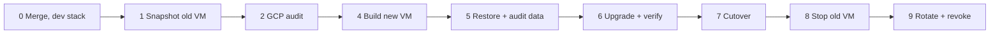

# Prod rebuild runbook (assume breach)

Mark's call on 2026-10-31: treat the current VM `omeka` as compromised. Prod moves to a new VM built from git and pinned upstream artifacts. Every secret the old VM held gets rotated. The rebuild also carries the PHP 8.5.12 / Omeka S 4.2.1 upgrade. Plan, versions and test results: [server-upgrade-2026-10.md](server-upgrade-2026-10.md).

Each numbered step needs Mark's explicit go-ahead (CLAUDE.md guardrails). Run `gcloud` on the laptop as Mark. Run VM commands over SSH on the VM the heading names.



Variables for the laptop shell:

```bash
P=folkloric-rite-468520-r2; Z=us-east1-b; R=us-east1
OLD=omeka; NEW=catalog-2026-11
VMSA=catalog-vm@$P.iam.gserviceaccount.com
OLDSA=915596988253-compute@developer.gserviceaccount.com
```

## 0. Laptop: merge, then upgrade the dev stack

1. Merge the upgrade branch into `main`. Record the merge commit as `SHA`.
2. In the main checkout:

```bash
make modules                                   # pinned third-party modules
docker compose up -d --build omeka             # PHP 8.5.12 + Omeka 4.2.1 image
docker compose exec -T db mariadb -uomeka -pomeka omeka -e \
  "ALTER TABLE faceted_browse_page ADD thumbnail_type VARCHAR(255) DEFAULT NULL AFTER resource_type"
```

3. Admin > Modules at localhost:8888: Upgrade Common, then Log, BulkEdit, Custom Vocab, Faceted Browse.
4. Add Common's index (its background launcher fails; see the plan):

```bash
docker compose exec -T db mariadb -uomeka -pomeka omeka -e \
  "ALTER TABLE value ADD INDEX idx_property_value_resource (property_id, value_resource_id), ALGORITHM=INPLACE, LOCK=NONE"
```

## 1. Preserve the old VM (5 min)

```bash
DISK=$(gcloud compute instances describe $OLD --zone $Z --project $P --format='value(disks[0].source.basename())')
gcloud compute snapshots create omeka-forensic-$(date +%Y%m%d) --source-disk $DISK --source-disk-zone $Z --project $P
gcloud compute instances describe $OLD --zone $Z --project $P \
  --format='value(machineType.basename(),tags.items,networkInterfaces[0].accessConfigs[0].natIP)'
gcloud compute disks describe $DISK --zone $Z --project $P --format='value(sizeGb)'
```

Write down the machine type, tags, IP and disk size. Keep the snapshot for 90 days.

## 2. Measure the GCP blast radius (15 min)

The old VM ran as `$OLDSA` with the `cloud-platform` scope. Root on the VM had every role that account holds.

```bash
gcloud projects get-iam-policy $P --flatten=bindings \
  --filter="bindings.members:serviceAccount:$OLDSA" --format='value(bindings.role)'
gcloud iam service-accounts keys list --iam-account $OLDSA --managed-by=user --project $P
gcloud logging read "protoPayload.authenticationInfo.principalEmail=\"$OLDSA\" AND logName:\"cloudaudit.googleapis.com%2Factivity\"" \
  --project $P --freshness=400d --limit 500 \
  --format='table(timestamp,protoPayload.methodName,protoPayload.resourceName)'
gcloud storage buckets describe gs://catalog-jonsarkin-backups \
  --format='yaml(versioning,retention_policy,soft_delete_policy)'
gcloud storage buckets get-iam-policy gs://catalog-jonsarkin-backups
```

Expected audit entries: storage writes from the backups. Escalate on anything else: `SetIamPolicy`, `CreateServiceAccountKey`, `compute.instances.insert`, firewall changes, `setMetadata` (SSH keys). A role of `roles/editor` on `$OLDSA` widens the review to every project resource. If the backups SA can overwrite or delete objects and versioning is off, treat older backups as equally suspect.

## 3. Optional: host triage on the old VM (30 min)

The 2026-10-31 read-only check covered the application layer (see the plan). These host checks add evidence. A rootkit can hide from them, so the rebuild goes ahead whatever they show.

```bash
ssh omeka.us-east1-b.folkloric-rite-468520-r2
sudo last -Faiw | head -40; sudo lastb -Fai | head -20
sudo grep -h "Accepted" /var/log/auth.log* | awk '{print $1,$2,$3,$9,$11}' | sort | uniq -c | sort -rn | head
for u in root ubuntu mark; do echo "== $u"; sudo cat /home/$u/.ssh/authorized_keys /root/.ssh/authorized_keys 2>/dev/null; done
sudo ls -la /etc/cron.d /etc/systemd/system; for u in root ubuntu mark; do sudo crontab -l -u $u; done
sudo find /etc /usr/local /opt /root /home -xdev -newer /etc/hostname -type f -mtime -120 | grep -vE '/\.cache/|/opt/catalog/' | head -50
sudo ss -tunap | grep -v -E '127.0.0.1|::1'
docker ps -a; docker images
sudo debsums -s 2>/dev/null | head      # sudo apt-get install debsums first
```

## 4. Build the new VM (45 min)

Laptop: a dedicated service account with minimal roles, a new static IP, the VM.

```bash
gcloud iam service-accounts create catalog-vm --project $P --display-name "catalog VM"
for r in roles/logging.logWriter roles/monitoring.metricWriter; do
  gcloud projects add-iam-policy-binding $P --member serviceAccount:$VMSA --role $r; done
gcloud iam service-accounts add-iam-policy-binding catalog-backups@$P.iam.gserviceaccount.com \
  --member serviceAccount:$VMSA --role roles/iam.serviceAccountTokenCreator --project $P
gcloud compute addresses create catalog-2026-11 --region $R --project $P
gcloud compute instances create $NEW --zone $Z --project $P \
  --machine-type <old machine type> --boot-disk-size <old size>GB \
  --image-family ubuntu-2404-lts-amd64 --image-project ubuntu-os-cloud \
  --service-account $VMSA --scopes cloud-platform \
  --address catalog-2026-11 --tags <old tags> \
  --shielded-secure-boot --shielded-vtpm --shielded-integrity-monitoring
gcloud compute config-ssh --project $P
```

New VM: packages from the Ubuntu archive and Google's Ops Agent. The host gets Docker, git and unzip only.

```bash
ssh $NEW.$Z.$P
sudo apt-get update && sudo apt-get -y upgrade
sudo apt-get -y install docker.io docker-compose-v2 git unzip
sudo usermod -aG docker $USER && exit      # log in again for the docker group
curl -sSO https://dl.google.com/cloudagents/add-google-cloud-ops-agent-repo.sh && sudo bash add-google-cloud-ops-agent-repo.sh --also-install
sudo mkdir -p /opt/catalog /var/www/omeka-s/files && sudo chown $USER /opt/catalog
git clone https://github.com/aphelionz/catalog.jonsarkin.com.git /opt/catalog
cd /opt/catalog && git checkout <SHA> && git log -1 --oneline
bash scripts/fetch-omeka-modules.sh
```

Secrets: generate new ones. Create the new Anthropic key and the new Gmail app password first, then paste them.

```bash
cd /opt/catalog && umask 077
cat > .env <<EOF
COMPOSE_FILE=docker-compose.prod.yml
MYSQL_DATABASE=omeka
MYSQL_USER=omeka
MYSQL_PASSWORD=$(openssl rand -hex 24)
MYSQL_ROOT_PASSWORD=$(openssl rand -hex 24)
ANTHROPIC_API_KEY=<new key>
SMTP_USER=<smtp user>
SMTP_PASS=<new app password>
EOF
touch acme.json && chmod 600 acme.json
```

`COMPOSE_FILE` makes every plain `docker compose` on the VM (the backup scripts included) read the prod file. The old VM ran `db`, `qdrant` and `clip-api` from the dev file.

Images: build both locally. The prod compose names `aphelionz/sarkin-clip-api`; a local build keeps Docker Hub out of the path, so skip `docker compose pull`.

```bash
docker compose build omeka
docker build -t aphelionz/sarkin-clip-api:latest -f sarkin-clip/Dockerfile.api sarkin-clip/
docker compose up -d db
```

## 5. Restore and audit the data (1 to 2 h)

Content freeze: announce it, then make zero admin edits on the old site from here to cutover.

Old VM: take a fresh dump into the bucket.

```bash
ssh omeka.us-east1-b.folkloric-rite-468520-r2 '/opt/catalog/scripts/backup-to-gcs.sh daily'
```

New VM: fetch the dump and audit it in a scratch container first.

```bash
G="gcloud storage --impersonate-service-account=catalog-backups@folkloric-rite-468520-r2.iam.gserviceaccount.com"
D=/tmp/restore; mkdir -p $D
$G ls -l gs://catalog-jonsarkin-backups/daily/ | tail -3
$G cp gs://catalog-jonsarkin-backups/daily/omeka-<stamp>.sql.gz $D/
docker run -d --name audit -e MARIADB_ROOT_PASSWORD=scratch mariadb:10.11
until docker exec audit healthcheck.sh --connect; do sleep 1; done
docker exec -e MYSQL_PWD=scratch audit mariadb -uroot -e "CREATE DATABASE omeka"
gunzip -c $D/omeka-*.sql.gz | docker exec -i -e MYSQL_PWD=scratch audit mariadb -uroot --one-database omeka
docker exec -i -e MYSQL_PWD=scratch audit mariadb -uroot omeka <<'SQL'
SELECT id, email, role, is_active, created, modified FROM user ORDER BY created;
SELECT id, owner_id, label, created, last_accessed, last_ip FROM api_key ORDER BY created;
SELECT id, is_active, version FROM module ORDER BY id;
SELECT id, slug, LEFT(navigation, 300) FROM site WHERE navigation REGEXP 'javascript:';
SELECT id, LEFT(value, 200) FROM setting WHERE value REGEXP '<script|javascript:|onerror=|onload=|<iframe|https?://';
SELECT site_id, id, LEFT(value, 200) FROM site_setting WHERE value REGEXP '<script|javascript:|onerror=|onload=|<iframe';
SELECT b.id, p.slug, LEFT(b.data, 200) FROM site_page_block b JOIN site_page p ON p.id = b.page_id
  WHERE b.data REGEXP '<script|javascript:|onerror=|onload=|<iframe';
SELECT resource_id, property_id, LEFT(COALESCE(value, uri), 200) FROM value
  WHERE value REGEXP '<script|javascript:|onerror=|onload=|<iframe' OR uri REGEXP '^javascript:';
SELECT id, ingester, LEFT(data, 200) FROM media WHERE ingester IN ('html', 'oembed') AND data REGEXP '<script|onerror=|<iframe';
SQL
docker rm -f audit
```

Expected: the known users and modules, settings whose URLs point at our own hosts, and page or media embeds Mark recognizes. Delete or fix anything else in the real import below, then record it here.

Import the `omeka` database only. The dump also carries the old `mysql` grants, and `--one-database` skips them.

```bash
cd /opt/catalog
gunzip -c $D/omeka-*.sql.gz | docker compose exec -T db sh -c 'MYSQL_PWD=$MARIADB_ROOT_PASSWORD mariadb -uroot --one-database omeka'
docker compose exec -T db sh -c 'MYSQL_PWD=$MARIADB_ROOT_PASSWORD mariadb -uroot omeka' <<'SQL'
TRUNCATE session;
DELETE FROM api_key;
DELETE FROM password_creation;
UPDATE user SET password_hash = CONCAT('!locked-', SHA2(RAND(), 256));
SELECT COUNT(*) items FROM item; SELECT COUNT(*) media FROM media;
SQL
```

Files: restore from the bucket (recovery runbook §4), then sweep for code and script-bearing files.

```bash
$G rsync --recursive gs://catalog-jonsarkin-backups/files/ /var/www/omeka-s/files/
cd /var/www/omeka-s/files
find . -type f | sed -nE 's/.*\.([^./]+)$/\1/p' | tr A-Z a-z | sort | uniq -c | sort -rn
find . -type f \( -iname '*.php*' -o -iname '*.phtml' -o -iname '*.phar' -o -iname '.htaccess' -o -iname '*.js' \) -print
find . -type f \( -iname '*.svg' -o -iname '*.htm*' -o -iname '*.xml' \) -print0 | xargs -0 -r grep -lis '<script\|onload=\|javascript:'
find original -type f -print0 | xargs -0 file --mime-type | grep -vE ': (image|video|audio)/|: application/pdf$'
sudo chown -R 33:33 /var/www/omeka-s/files
```

Delete every hit from the first `find`. Review the rest with Mark before deleting.

Qdrant and the search index: follow recovery runbook §5, but skip its `cp $D/env` line, since this VM has a fresh `.env`. After cutover, run Admin > Enrich Fields > Ingest All Items. It calls clip-api only (zero Claude cost) and rebuilds the vectors from the audited DB.

## 6. Upgrade and verify on the new VM (30 min)

```bash
cd /opt/catalog
docker compose exec -T db sh -c 'MYSQL_PWD=$MARIADB_ROOT_PASSWORD mariadb-dump -uroot omeka' | gzip > /tmp/pre-upgrade.sql.gz
docker compose exec -T db sh -c 'MYSQL_PWD=$MARIADB_ROOT_PASSWORD mariadb -uroot omeka -e \
  "ALTER TABLE faceted_browse_page ADD thumbnail_type VARCHAR(255) DEFAULT NULL AFTER resource_type"'
docker compose up -d
```

Set Mark's admin password. The prompt reads it silently; the hash goes to the DB.

```bash
read -rs PW; H=$(printf '%s' "$PW" | docker compose exec -T omeka php -r 'echo password_hash(stream_get_contents(STDIN), PASSWORD_DEFAULT);'); unset PW
printf "UPDATE user SET password_hash='%s' WHERE email='%s';\n" "$H" "<mark's admin email>" | \
  docker compose exec -T db sh -c 'MYSQL_PWD=$MARIADB_ROOT_PASSWORD mariadb -uroot omeka'
```

Test the new VM by IP before DNS moves. Traefik serves a self-signed cert until DNS points here, so use `-k`.

```bash
NEWIP=$(gcloud compute addresses describe catalog-2026-11 --region $R --project $P --format='value(address)')
for u in /api/items /faceted-browse/2 /item/7308 /visual-search /admin; do
  curl -sk -o /dev/null -w "%{http_code} $u\n" --resolve catalog.jonsarkin.com:443:$NEWIP "https://catalog.jonsarkin.com$u"; done
```

For the admin, add `<NEWIP> catalog.jonsarkin.com` to the laptop's `/etc/hosts`, accept the self-signed cert, and remove the line before step 7:

1. Modules: Upgrade Common, then Log, BulkEdit, Custom Vocab, Faceted Browse.
2. Common's index:

```bash
docker compose exec -T db sh -c 'MYSQL_PWD=$MARIADB_ROOT_PASSWORD mariadb -uroot omeka -e \
  "ALTER TABLE value ADD INDEX idx_property_value_resource (property_id, value_resource_id), ALGORITHM=INPLACE, LOCK=NONE"'
```

3. Check: faceted browse with a filter, an item page with similar works, visual search, RapidEditor loads, Enrich Fields loads, ICC Thumbnailer page, a test upload through Simple Upload (its thumbnails keep the ICC profile), "Forgot password" email arrives.

## 7. Cutover (15 min plus DNS)

1. One day ahead: lower the TTL of the `catalog.jonsarkin.com` A record at DreamHost to 300.
2. Point the A record at `$NEWIP`.
3. Watch Traefik get the certificate: `docker compose logs -f traefik | grep -i acme`.
4. Verify from the laptop:

```bash
curl -4 -sS -o /dev/null -w "%{http_code}\n" https://catalog.jonsarkin.com/api/items   # 200
curl -4 -sS -o /dev/null -w "%{http_code}\n" https://catalog.jonsarkin.com/            # 301
```

5. Install the cron jobs from the repo scripts:

```bash
crontab - <<'EOF'
PATH=/snap/bin:/usr/local/sbin:/usr/local/bin:/usr/sbin:/usr/bin:/sbin:/bin
SHELL=/bin/bash
0 2 * * *  /opt/catalog/scripts/backup-to-gcs.sh daily
0 3 * * *  /opt/catalog/scripts/backup-to-gcs.sh files
0 4 * * 0  /opt/catalog/scripts/backup-to-gcs.sh weekly
0 5 1 * *  /opt/catalog/scripts/backup-to-gcs.sh monthly
17 * * * * /opt/catalog/scripts/backup-monitor.sh >/dev/null 2>&1
30 1 * * * /opt/catalog/scripts/prune-sessions.sh >/dev/null 2>&1
EOF
/opt/catalog/scripts/backup-to-gcs.sh daily     # proves the new SA can write
```

6. Laptop: re-run `scripts/setup-gcp-monitoring.sh` so host alerts follow the new instance. Update the SSH host alias in `Makefile` (`PROD_HOST`) and `omeka/ansible/inventory.ini` to `$NEW.$Z.$P`.
7. End the content freeze.

## 8. Stop the old VM

```bash
ssh omeka.us-east1-b.folkloric-rite-468520-r2 '/opt/catalog/scripts/backup-to-gcs.sh accesslog $(date -u +%Y-%m)'
gcloud compute instances stop $OLD --zone $Z --project $P
```

Keep its disk and the forensic snapshot for 90 days. Deletion is Mark's call after that.

## 9. Rotate and revoke

| Secret | Held by the old VM in | Action |
|---|---|---|
| Anthropic API key | `.env` | Revoke the old key in the Anthropic console (the new VM has a new one). |
| Gmail app password (SMTP) | `.env` | Revoke the old app password in the Google account. |
| MariaDB passwords | `.env`, DB grants | Done: the new VM generated new ones and skipped the old grants. |
| Omeka passwords, API keys, sessions | DB | Done in step 5. Each user sets a new password through "Forgot password". Recreate API keys only where needed. |
| SiteLockdown password | DB setting | Set a new one in the module config. |
| Default compute SA `$OLDSA` | VM identity | Remove its `serviceAccountTokenCreator` binding on `catalog-backups` and every role found in step 2. Delete any user-managed keys found. |
| SSH keys in `authorized_keys` and GCE metadata | VM | Remove old entries from project metadata. Mark checks the laptop's `~/.ssh/config` for `ForwardAgent` to this host; if it was on, generate a new laptop key. |
| TLS key in `acme.json` and `/etc/letsencrypt` | VM | The new VM issued its own. Revoking the old certificate is optional. |
| Old static IP | GCP | Release it after the 90 days. |

## Rollback

- Before step 7: users still reach the old VM. Stop or delete the new one.
- Upgrade problem on the new VM: restore `/tmp/pre-upgrade.sql.gz`, check out the pre-upgrade commit for `omeka/Dockerfile`, `omeka/volume/modules/FacetedBrowse` and `scripts/fetch-omeka-modules.sh`, set the old pins below, run `bash scripts/fetch-omeka-modules.sh`, then `docker compose build omeka && docker compose up -d omeka`.
- New VM unusable after cutover: point DNS back to the old IP and start the old VM. It counts as compromised, so use it for hours at most.

Pre-upgrade pins:

| Item | Version | SHA-256 |
|---|---|---|
| Base image | `giocomai/omeka-s-docker:v4.2.0` | `sha256:89169955b6090d8357d576072f34b239e533d50bf711094fb9b718a713b08741` (digest) |
| Common | 3.4.82 | `94daefe938d9b7cf123ef90190c5859bdaaedd8b779a1a3d6b24dc36e78a7f47` |
| Log | 3.4.37 | `8271d49115f9e7825609a3a8f392cd2efdf84a0cd8d390acc5b908f09b998abc` |
| BulkEdit | 3.4.39 | `ee704bb71d4e9b3f5ba76761bc7f9f08e118b5f646cc4c211cd8c8fd9dc6a378` |
| CustomVocab | 2.0.2 | `7d405fa9293af9a679430bf0b317d7b1e71f36ae2951c20798a5d7a3b4283993` |

## After the rebuild

`make deploy` rsyncs the laptop tree over `/opt/catalog`, which is now a git clone. Moving deploys to `git checkout <sha>` plus `scripts/fetch-omeka-modules.sh` on the VM keeps prod equal to a known commit. That change is a follow-up for Mark to approve.
